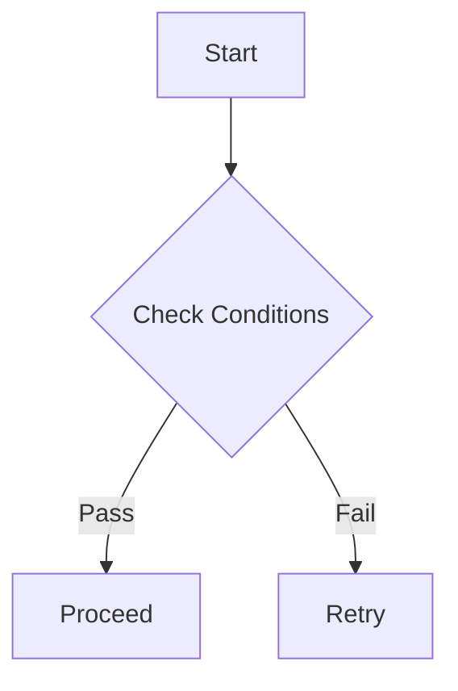
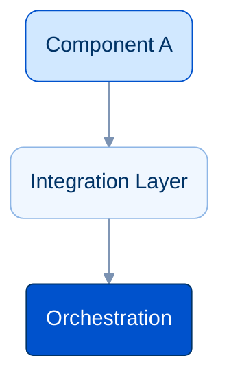

# Mermaid Diagrams in b.polente.de

This repository renders Mermaid diagrams to SVG at build time using Playwright and `markdown-it-mermaid-server`.

## 1. Syntax & Fencing

Always wrap diagrams in a fenced code block with language `mermaid`:

````markdown

````

## 2. Diagram Labeling Best Practices

To avoid build-time parser crashes in `mermaid-cli-batch`:
- **Quote all node labels containing special characters**:
  Always use quotes if the label includes parentheses, brackets, colons, or punctuation.
  - Good: `id["Step 1: Setup (Figma)"]`
  - Bad: `id[Step 1: Setup (Figma)]`
- **Line breaks**: Use `<br/>` inside double quotes:
  - Good: `A["Step 1: Ingestion<br/>(Batch Pipeline)"]`
- **Avoid complex HTML tags**: Do not use `<span>`, `<div>`, or complex inline styles inside node labels.

## 3. Theme & Styling Conventions

This blog commonly uses a "Cold Blue Technical Theme" across technical posts. Here is the standard reference palette:



## 4. Verification

Whenever you add or modify a diagram:
1. Run `npm run build` to verify that `markdown-it-mermaid-server` renders the diagram cleanly without errors.
2. Temporary files are stored in `mermaidTmp/` during the build and cleaned up automatically.
