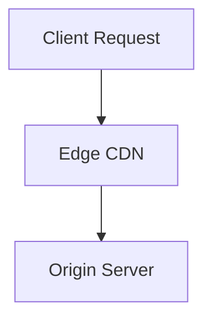

# Creating a New Blog Post

Follow these step-by-step procedures to author or scaffold a new post for **b.polente.de**.

## 1. Directory Structure

Every post **must** have its own dedicated directory in `content/blog/`:

```bash
content/blog/<PostSlug>/
├── <PostSlug>.md
└── <image-assets> (e.g. cover.png, screenshot.webp)
```

- Choose a concise, CamelCase or kebab-case folder name matching the markdown filename.
- Example: `content/blog/ModernToolingInPractice/ModernToolingInPractice.md`

## 2. Front Matter Schema

The markdown file must begin with YAML frontmatter:

```yaml
---
title: "Clear, Engaging Title"
description: "A single, concise summary sentence used for cards, search results, and RSS feeds."
date: YYYY-MM-DD
draft: true # Mark true during drafting; remove or set false when ready to publish
tags:
  - Software Engineering
  - Architecture
---
```

### Important Front Matter Rules:
- **DO NOT** specify `layout`. `content/blog/blog.11tydata.js` automatically applies `layouts/post.njk`.
- **DO NOT** add `posts` to `tags`. It is already injected automatically.
- Tag casing will be canonicalized automatically across the site, but prefer title case (e.g., `Software Engineering`).
- Always keep `draft: true` until all referenced images/assets are present in the folder.

## 3. Authoring Conventions

### Images
Never use Markdown image syntax ``. Always use the Nunjucks image shortcode:

```njk

```
- Place the image file in the same directory as the markdown file.
- Use relative path `./filename.ext`.
- Supported formats: `.png`, `.jpg`, `.jpeg`, `.webp`, `.svg`.

### Mermaid Diagrams
Use fenced code blocks with language `mermaid`:

````markdown

````
Mermaid diagrams are automatically compiled into SVGs at build time. Keep node text clean and avoid complex inline HTML inside diagram labels.

### Headings and Table of Contents
- Use `##` (h2) for all main sections.
- The template parses all `<h2>` headings to automatically build the "On this page" table of contents.
- Use `###` (h3) for subsections.

### Footnotes
Use standard footnote notation:
```markdown
This concept is explained in detail by the specification.[^1]

[^1]: Full citation, link, or note text.
```

## 4. Verification

Before marking `draft: false` and finalizing:
1. Run `npm start` and preview the post locally at `http://localhost:8080/`.
2. Ensure all referenced images exist on disk.
3. When ready to publish, set `draft: false` (or remove the line).
4. Run `npm test` to verify the build, search index generation, and validate that there are no broken links or missing canonical tags.
