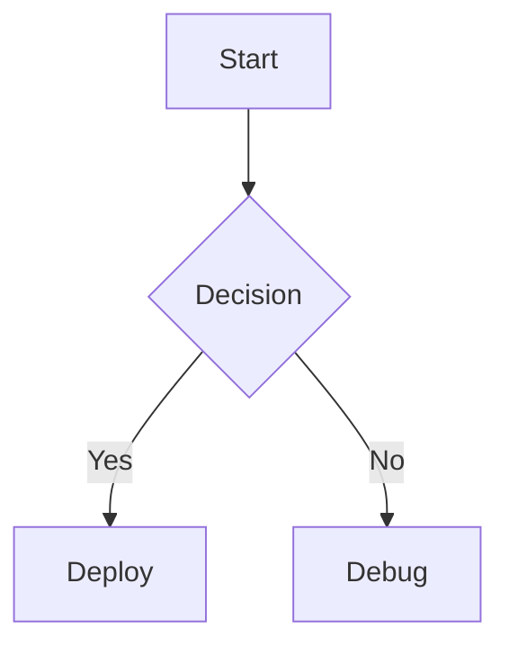

# Repository Guide & Rules for AGY (`b.polente.de`)

This repository powers **b.polente.de** ("Cases by Holger Hellinger"), a technical blog built with [Eleventy](https://www.11ty.dev/) (v3) on Node.js (>=22).

---

## 1. Tech Stack & Environment

- **Node.js**: `>= 22` (specified in [.nvmrc](.nvmrc) and [package.json](package.json)).
- **Static Site Generator**: Eleventy 3 (`@11ty/eleventy`).
- **Templating**: Nunjucks (`njk`).
- **Markdown**: `markdown-it` configured with:
  - `markdown-it-anchor` (header anchors and TOC).
  - `markdown-it-footnote` (`[^1]` footnote syntax and back-links).
  - `markdown-it-mermaid-server` (renders fenced ` ```mermaid ` blocks to SVG at build time).
- **Search**: [Pagefind](https://pagefind.app/) builds an offline client-side search index into `_site/pagefind/`.
- **Image Pipeline**: `@11ty/eleventy-img` generates AVIF and WebP responsive formats.
- **Dependencies & Patches**: `patch-package` runs on `postinstall` to apply patches from [patches/](patches/) to `markdown-it-mermaid-server`.
- **Browser Automation**: Playwright Chromium (needed for Mermaid diagram build-time rendering).

---

## 2. Directory Layout

```text
.
├── content/                     # Eleventy input directory
│   ├── blog/                    # Blog post directories (each post in its own folder)
│   │   ├── <PostSlug>/          # Dedicated directory for a post
│   │   │   ├── <PostSlug>.md    # Post content & front matter
│   │   │   └── <image>.<ext>    # Co-located images
│   │   └── blog.11tydata.js     # Applies layouts/post.njk and the 'posts' collection tag
│   ├── index.njk                # Home page
│   ├── feed/                    # RSS / Atom / JSON feeds
│   └── search.njk               # Pagefind search page
├── _includes/                   # Nunjucks layouts and partials
│   ├── layouts/
│   │   ├── base.njk             # Base HTML skeleton
│   │   ├── post.njk             # Post template (TOC, header, tags, footer)
│   │   └── home.njk             # Home layout
│   └── postslist.njk            # Reusable post listing component
├── _data/
│   └── metadata.js              # Site metadata (title, URL, author info)
├── public/                      # Static assets copied directly to site root (_site/)
│   ├── css/                     # Stylesheets (index.css, prism theme, etc.)
│   ├── img/                     # Site-wide icons, favicons, avatars
│   └── robots.txt
├── eleventy.config.js           # Core Eleventy config (plugins, filters, collections, md rules)
├── eleventy.config.images.js    #  Nunjucks shortcode
├── eleventy.config.drafts.js    # Draft filtering (BUILD_DRAFTS env variable)
├── patches/                     # Patches applied via patch-package
├── scripts/
│   └── check-site.js            # Post-build link & canonical URL validator
├── .agents/                     # AGY agent workspace skills and configs
└── _site/                       # Build output (git-ignored)
```

---

## 3. Essential Commands

| Command | Action | Notes |
| :--- | :--- | :--- |
| `npm start` | Starts local dev server on `http://localhost:8080/` | Includes posts marked `draft: true`. |
| `npm run build` | Cleans `_site/`, runs Eleventy, and builds Pagefind index | Skips drafts. Run before deployment. |
| `npm test` | Runs `npm run build` followed by `node scripts/check-site.js` | **Mandatory check** before commits/PRs. |
| `npm run clean` | Removes `_site/` directory | |
| `npx playwright install chromium` | Installs Playwright Chromium | Required if Mermaid rendering fails. |

---

## 4. Authoring Guidelines & Post Conventions

### A. Post Location & Naming
Every blog post **must** reside in its own folder under `content/blog/`:
```text
content/blog/MyPostTitle/
├── MyPostTitle.md
└── diagram.png
```
- Folder name and markdown file name should match using CamelCase or hyphens.
- Store all images referenced by the post inside this folder.

### B. Front Matter Schema
```yaml
---
title: "Article Title"
description: "A single concise sentence for cards, search results, and RSS feeds."
date: YYYY-MM-DD
draft: true # Set to true while writing; remove or set false when publishing
tags:
  - Architecture
  - AI
---
```
- **Do NOT** specify `layout` in frontmatter (handled by [content/blog/blog.11tydata.js](content/blog/blog.11tydata.js)).
- **Do NOT** add `posts` to `tags` (handled by [content/blog/blog.11tydata.js](content/blog/blog.11tydata.js)).
- **Tags** are automatically slugified and aggregated in [eleventy.config.js](eleventy.config.js). The most frequently used casing becomes canonical.
- **Drafts**: Any post with `draft: true` will be excluded from production builds (`npm run build`) and included only in `npm start`.

### C. Responsive Images Shortcode
Never use standard markdown `` for post images. Always use the Nunjucks `` shortcode:
```njk

```
- Path must be relative to the markdown file (`./<filename>`).
- The image shortcode generates AVIF and WebP responsive sizes automatically with lazy loading.

### D. Mermaid Diagrams
Use fenced code blocks with language `mermaid`:
````markdown

````
- Rendered during build into SVG by `markdown-it-mermaid-server`.
- Keep labels clean and avoid complex HTML in node labels to ensure headless browser rendering succeeds.

### E. Footnotes & Headings
- **Headings**: Use `##` (h2) for primary section headings. The post template automatically parses `<h2>` tags to generate the "On this page" table of contents.
- **Footnotes**: Use `[^1]` inline and define at the bottom:
  ```markdown
  This statement needs a reference.[^1]

  [^1]: Full reference details and URL.
  ```

### F. Media Files (Audio / Video)
- `.mp3`, `.mp4`, and `.wav` placed anywhere under `content/` are automatically copied to `/media/` on build.

---

## 5. Quality Assurance & Verification Rules

1. **Verify Integrity**: Always run `npm test` after modifying content or configuration.
2. **Broken Link Guard**: `scripts/check-site.js` checks every internal `href` and `src` attribute across all built HTML pages in `_site/`. Never commit broken links.
3. **Canonical URLs**: Every page must have a valid `rel="canonical"` tag (enforced by `check-site.js`).
4. **Preserve Patches**: Never remove or bypass `patch-package` in `patches/`.
5. **Never Commit Build Output**: `_site/` and `mermaidTmp/` must remain in `.gitignore`.
